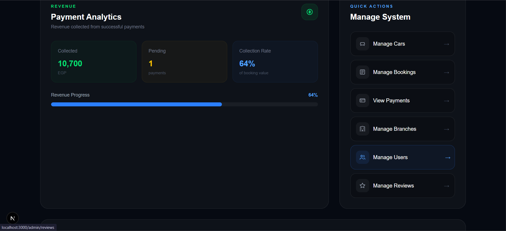
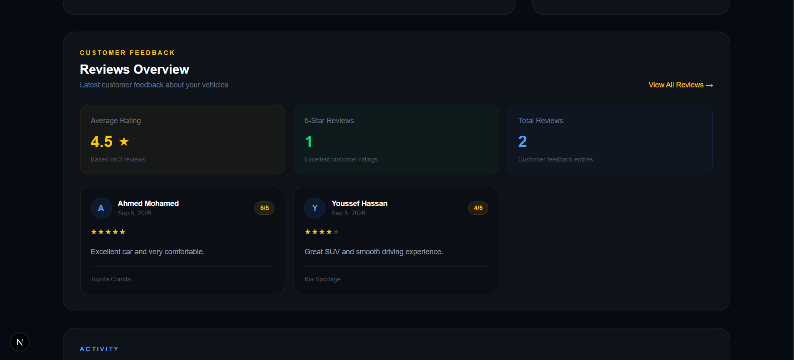
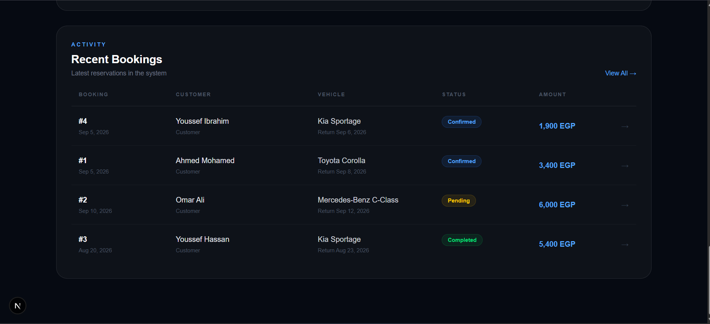

# 🚗 Car Rental Management System

A full-stack **Car Rental Management System** built to provide a modern and efficient platform for managing rental cars, bookings, branches, categories, payments, customer reviews, and more.

The system consists of a **Next.js frontend** connected to a **Laravel REST API backend** with a **MySQL database**.

---

## ✨ Features

* 🚗 Browse available rental cars
* 🔎 View detailed car information
* 📅 Create and manage bookings
* 💳 Booking and payment flow
* ⭐ Customer reviews and ratings
* 🤖 AI-powered assistant
* 🏢 Branch management
* 🚘 Car category management
* 📊 Car availability and rental status
* 🛠️ Admin dashboard
* 📱 Responsive and modern user interface
* 🔗 RESTful API integration

---

## 🛠️ Technologies

### Frontend

* Next.js
* React
* TypeScript
* Tailwind CSS

### Backend

* Laravel
* PHP
* REST API
* MySQL

### Tools

* Git
* GitHub
* Postman
* XAMPP

---

## 📸 Screenshots

### 🏠 Home Page


### 🚗 Cars Page


### 🚘 Car Details


### 📅 Booking Details


### 🤖 AI Assistant


### 🛠️ Admin Dashboard








---

## 📁 Project Structure

```
car-rental-system/
│
├── backend/
│   ├── app/
│   ├── database/
│   ├── routes/
│   ├── resources/
│   └── ...
│
├── frontend/
│   ├── app/
│   │   ├── bookings/
│   │   ├── cars/
│   │   ├── payment/
│   │   └── ...
│   └── ...
│
├── screenshots/
│   ├── home-page.png
│   ├── car-page.png
│   ├── car-details.png
│   ├── booking-details-page.png
│   ├── ai-assistant-page.png
│   ├── admin-dashboard.png
│   ├── admin-dashboard-1.png
│   ├── admin-dashboard-2.png
│   └── admin-dashboard-3.png
│
└── README.md
```

---

## ⚙️ Installation

### 1. Clone the Repository

```
git clone https://github.com/YOUR_USERNAME/car-rental-system.git

cd car-rental-system
```

---

### 2. Backend Setup

Navigate to the backend directory:

```
cd backend
```

Install Laravel dependencies:

```
composer install
```

Create the environment file:

```
cp .env.example .env
```

Generate the application key:

```
php artisan key:generate
```

Configure your database credentials inside the `.env` file.

Run the database migrations:

```
php artisan migrate
```

Start the Laravel development server:

```
php artisan serve
```

The backend API will run at:

```
http://127.0.0.1:8000
```

---

### 3. Frontend Setup

Open another terminal and navigate to the frontend:

```
cd frontend
```

Install dependencies:

```
npm install
```

Create a `.env.local` file and add:

```
NEXT_PUBLIC_API_URL=http://127.0.0.1:8000/api
```

Start the Next.js development server:

```
npm run dev
```

The frontend will run at:

```
http://localhost:3000
```

---

## 🔐 Environment Variables

### Frontend

```
NEXT_PUBLIC_API_URL=http://127.0.0.1:8000/api
```

### Backend

Configure the Laravel `.env` file with your database and application settings.

> Never commit `.env` or other files containing sensitive credentials to GitHub.

---

## 🔄 System Architecture

```
┌──────────────────────┐
│   Next.js Frontend   │
│   React + TypeScript │
└──────────┬───────────┘
           │
           │ REST API
           ▼
┌──────────────────────┐
│   Laravel Backend    │
│      PHP / API       │
└──────────┬───────────┘
           │
           ▼
┌──────────────────────┐
│    MySQL Database    │
└──────────────────────┘
```

---

## 📌 Main Modules

| Module          | Description                                       |
| --------------- | ------------------------------------------------- |
| Cars            | Browse and manage rental cars                     |
| Car Details     | Display detailed information about each car       |
| Bookings        | Create and manage rental bookings                 |
| Payments        | Handle the booking payment flow                   |
| Reviews         | Customer ratings and reviews                      |
| AI Assistant    | Assist users with car rental-related interactions |
| Categories      | Organize cars by category                         |
| Branches        | Manage rental locations                           |
| Admin Dashboard | Manage and monitor the rental system              |

---

## 🚀 Future Improvements

* 🔐 User authentication and authorization
* 👨‍💼 Advanced admin management
* 💳 Online payment gateway integration
* 🔎 Advanced car search and filtering
* 📋 Booking history
* 📧 Email notifications
* 📊 Advanced analytics and reporting
* ☁️ Production deployment

---

## 👨‍💻 Developer

**Youssef Ibrahim**

Computer Science Student
AI Specialization

---

## 📄 License

This project was developed for educational and development purposes.
