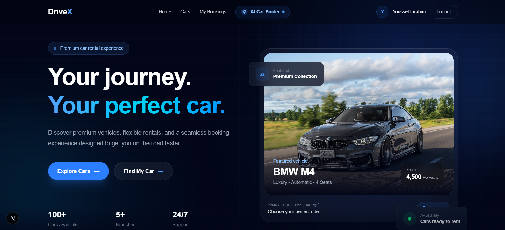
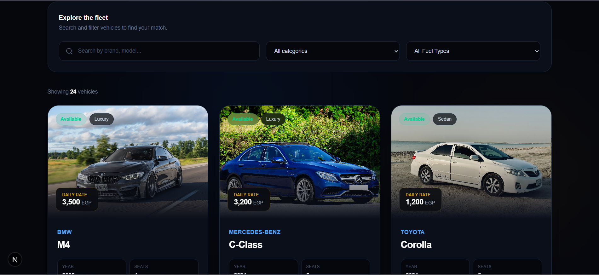
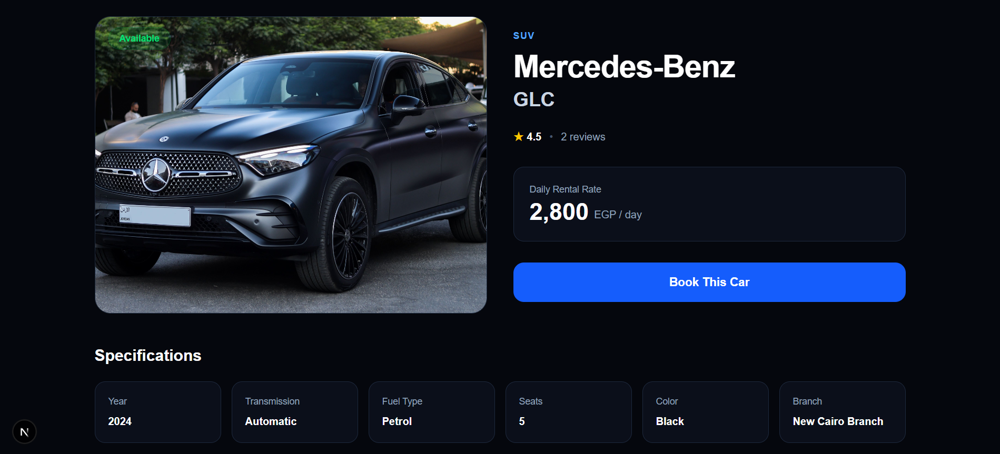
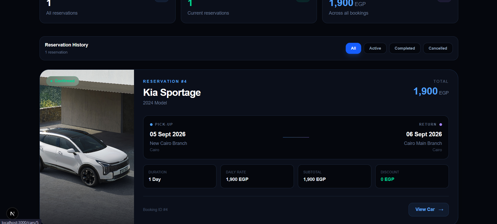
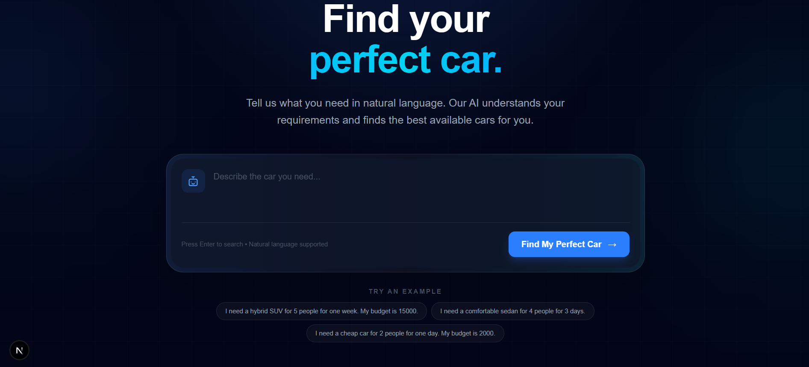
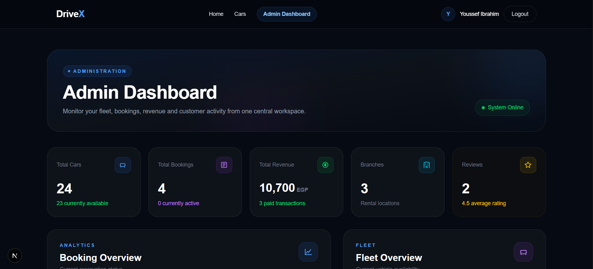
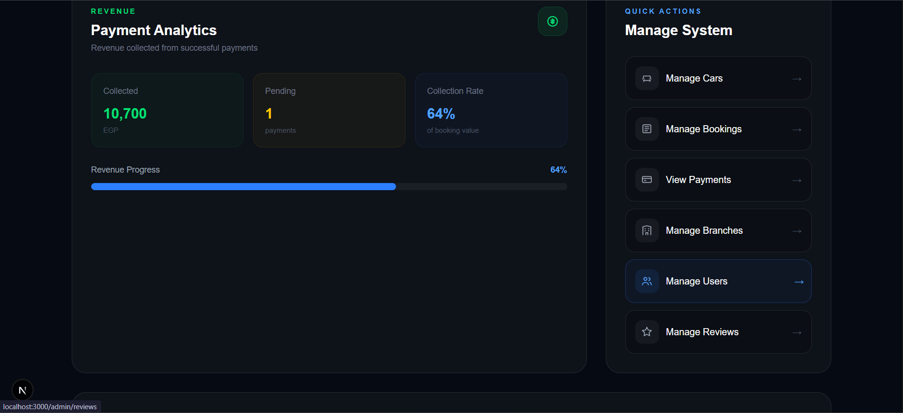
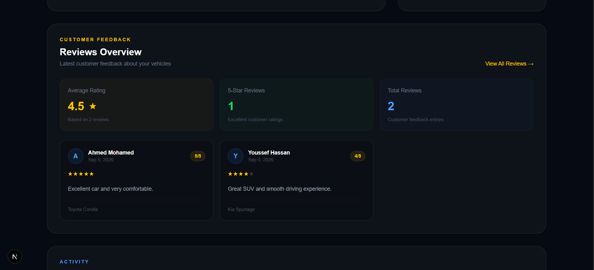
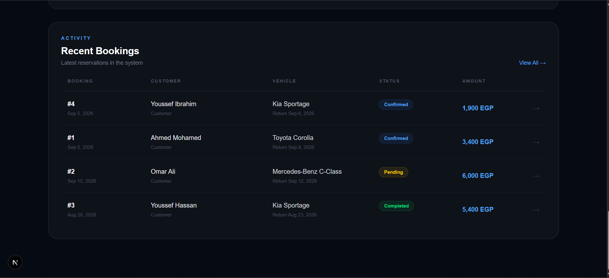

# 🚗 DriveX — Car Rental Management System

A full-stack car rental platform designed to simplify vehicle discovery, rental bookings, payment workflows, customer reviews, and fleet management through a modern web interface.

## ✨ Features

### Customer Experience
- Browse available rental cars and view detailed vehicle information.
- Explore car categories and rental branches.
- Create and manage rental bookings.
- Follow the booking payment flow.
- Rate completed rentals and submit customer reviews.
- Get smart car recommendations: rule-based scoring over the live fleet, with a reason for every score (see [`ML/README.md`](ML/README.md)).

### Administration
- Admin dashboard for managing the rental system.
- Manage cars, categories, and branches.
- View and manage customer bookings.
- Manage users, payments, and customer reviews.
- Track rental availability and booking status.

### Technical Highlights
- Frontend and backend communicate through a REST API.
- Laravel backend with MySQL database integration.
- Token authentication (Laravel Sanctum) with role-based access: `admin`, `staff`, `customer`.
- Prices, availability and payment status are always computed on the server.
- Feature tests for authorization, booking, payment and recommendations.
- Reusable UI components and responsive page layouts.

## 🛠️ Tech Stack

| Layer | Technologies |
|---|---|
| Frontend | Next.js, React, TypeScript, Tailwind CSS |
| Backend | PHP, Laravel |
| Database | MySQL |
| API | REST API |
| Development Tools | Git, GitHub, Postman, XAMPP |

## 📸 Screenshots

### Home Page


### Cars Listing


### Car Details


### Booking


### Smart Recommendations


### Admin Dashboard





## 📁 Project Structure

```text
car-rental-system/
├── backend/
│   ├── app/
│   ├── config/
│   ├── database/
│   ├── routes/
│   └── ...
├── frontend/
│   ├── app/
│   │   ├── admin/
│   │   ├── bookings/
│   │   ├── cars/
│   │   ├── payment/
│   │   ├── recommendations/
│   │   └── reviews/
│   └── ...
├── ML/                 # dataset prep + recommender research (see ML/README.md)
├── ML_old_backup/      # trained ranker experiments and metrics
├── screenshots/
└── README.md
```

## ⚙️ Getting Started

### Prerequisites

Install the following before running the project:

- PHP and Composer
- Node.js and npm
- MySQL
- Git

### 1. Clone the Repository

```bash
git clone https://github.com/Youssef-ibrahim200038542/car-rental-system.git
cd car-rental-system
```

### 2. Configure the Backend

```bash
cd backend
composer install
```

Create your local environment file from the example:

```bash
cp .env.example .env
```

On Windows PowerShell, you can use:

```powershell
Copy-Item .env.example .env
```

Configure your database connection in `backend/.env` (MySQL by default; for a quick local run set `DB_CONNECTION=sqlite` and create `database/database.sqlite`), then run:

```bash
php artisan key:generate
php artisan migrate --seed
php artisan storage:link
php artisan serve
```

`GEMINI_API_KEY` is optional. Without it, the natural-language recommendation endpoint falls back to a keyword parser.

The Laravel development server normally runs at:

```text
http://127.0.0.1:8000
```

#### Demo accounts (from the seeder)

| Role | Email | Password | Can do |
|---|---|---|---|
| Admin | `admin@carrental.com` | `password` | Everything, including cars, branches, categories and user roles |
| Staff | `staff@carrental.com` | `password` | Bookings, payments, maintenance; read users |
| Customer | `ahmed@example.com` | `password` | Own bookings, payments and reviews |

These are development credentials only. Never run the seeder on a public server.

#### Run the tests

```bash
php artisan test
```

### 3. Configure the Frontend

Open a new terminal at the project root:

```bash
cd frontend
npm install
```

Create `frontend/.env.local` and configure the backend API URL:

```env
NEXT_PUBLIC_API_URL=http://127.0.0.1:8000/api
```

Start the frontend:

```bash
npm run dev
```

Before pushing, check that it builds and lints cleanly:

```bash
npm run lint
npm run build
```

Open the local frontend URL shown in the terminal, usually:

```text
http://localhost:3000
```

## 🔐 Environment Configuration

- Keep backend credentials in `backend/.env`.
- Keep local frontend environment settings in `frontend/.env.local`.
- Never commit real passwords, API keys, tokens, or other secrets.
- Use example environment files to document required variable names without exposing secret values.
- Set `APP_DEBUG=false` anywhere other than your own machine, so errors never show stack traces.
- API tokens expire after 7 days (`SANCTUM_TOKEN_EXPIRATION`, in minutes).

## 👨‍💻 Developer

**Youssef Ibrahim**

Computer Science Student — AI Specialization  
Modern web development | React | PHP | Laravel | MySQL

## 📄 License

This project was developed for educational and portfolio purposes.
